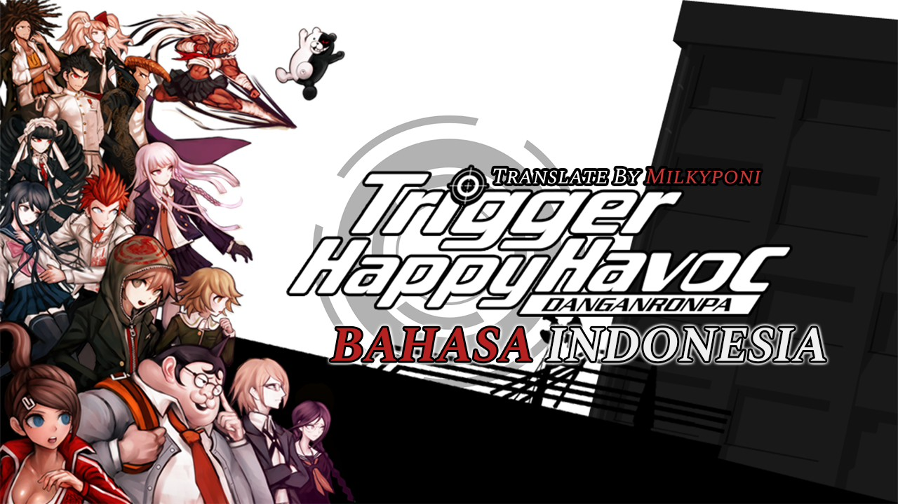

<p align="center">
  
</p>

<h1 align="center">Danganronpa: Trigger Happy Havoc — Indonesian Localization Mod</h1>

<p align="center">
  <b>Mod Lokalisasi & Subtitle Bahasa Indonesia Lengkap untuk Game Danganronpa: Trigger Happy Havoc (Steam PC)</b><br>
  <i>Penyelia & Pengarah: Milky Poni | Rekayasa Mod & Lokalisasi: Ochi (Milky Brain)</i>
</p>

<p align="center">
  <a href="https://github.com/Milkyponi/Danganronpa1IndoLocalization/releases"></a>
  
  
  
</p>

---

Mod lokalisasi Bahasa Indonesia untuk game visual novel misteri persidangan **Danganronpa: Trigger Happy Havoc** (Steam PC) karya **Milky Brain Game Modding & Localization Division**.

Dibuat khusus bagi gamer Indonesia yang ingin menikmati atmosfer ketegangan psikologis di Hope's Peak Academy, investigasi TKP pembunuhan yang penuh misteri, serta dinamika perdebatan sidang kelas (*Class Trial*) yang intens—dalam Bahasa Indonesia yang hidup, luwes, alami, dan berkarakter tanpa terjemahan mesin yang kaku.

---

## ✨ Fitur Utama & Standar Kualitas Lokalisasi

### 1. Terjemahan Kontekstual & Penuh Jiwa Karakter (Anti-Google Translate)
Diterjemahkan secara mendalam berbasis adegan utuh (*scene-level*), mempertahankan emosi otentik, sarkasme, keputusasaan, dan kepribadian unik dari ke-15 siswa berbakat (*Ultimate Students*):
* **Makoto Naegi**: Siswa biasa yang terseret ke dalam konspirasi mematikan; monolog batinnya reflektif, penuh empati, namun bertekad bulat membela kebenaran.
* **Kyoko Kirigiri**: Detektif misterius yang dingin, tenang, analitis, dan selalu menuntun persidangan dengan logika tajam tanpa terpengaruh emosi.
* **Byakuya Togami**: Pewaris konglomerat yang arogan, sinis, memandang permainan bunuh diri sebagai ajang pembuktian intelektual semata.
* **Toko Fukawa & Genocider Syo**: Perbedaan kontras antara Toko yang pemalu, paranoid, dan penuh rasa curiga, dengan alter-ego Genocider Syo yang histeris, liar, maniak, dan bersuara melengking tajam.
* **Monokuma**: Kepala sekolah boneka beruang yang kejam, licik, penuh humor gelap (*dark humor*), dan tawa khas yang mengintimidasi.
* **Karakter Lainnya**: Logika ningrat palsu Celestia Ludenberg, kepribadian kasar namun setia kawan Mondo Owada, integritas ksatria Sakura Ogami, teriakan disiplin kaku Kiyotaka Ishimaru, hingga ocehan ramalan santai Yasuhiro Hagakure.

### 2. Sinkronisasi Fonetik Kata Terbata-Bata (*Stuttering Synchronization*)
Mengatasi cacat fatal desinkronisasi pada modifikasi dialog game, di mana suku kata gagap sering kali menjiplak huruf asing:
* *"Wh-What...?"* ➔ *"A-Apa...?"*
* *"N-Nothing, I'm just..."* ➔ *"T-Tidak ada apa-apa, cuma..."* / *"B-Bukan apa-apa..."*
* *"S-Sorry..."* ➔ *"M-Maaf..."*
* *"Y-You're right."* ➔ *"K-Kau benar."*
* *"I-I know what you thought!"* ➔ *"A-Aku tahu apa yang barusan kau pikirkan!"*
* *"M-Murderer!"* ➔ *"P-Pembunuh!"*

### 3. Standar Kebijakan Bahasa Resmi (English UI / Indonesian Dialogue)
* **Dialog & Narasi (100% Bahasa Indonesia)**: Seluruh cerita, investigasi, debat sidang kelas, Free Time Events, dan School Mode diterjemahkan menyeluruh ke Bahasa Indonesia.
* **UI & HUD (100% Original English)**: Menu utama, opsi kontrol/pengaturan, HUD tempur persidangan, nama karakter, dan nama skill tetap original English demi kenyamanan navigasi dan keselarasan dengan panduan build internasional.
* **Deskripsi Penjelasan (Bahasa Indonesia)**: Deskripsi bukti investigasi (*Truth Bullets / Kotodama*), deskripsi hadiah (*Presents*), laporan rapor siswa (*Report Cards*), dan 16 aturan sekolah Monokuma diterjemahkan secara lengkap ke Bahasa Indonesia.

### 4. Preservasi Penuh Token Kontrol & Warna Engine
Seluruh tag pemformatan visual Spike Chunsoft (`<CLT 3>` untuk kata kunci kebenaran, `<CLT 4>` untuk monolog batin Makoto, serta penutup `<CLT>`) dan token tombol kontrol (`%CTRL_MAP%`, `%CTRL_RUN%`, `%HLP_INTERACT%`) dipertahankan presisi bit-demi-bit agar efek teks dinamis di dalam game tidak rusak.

---

## 📊 Cakupan Konten (100% Paripurna — 52.691 Entri Teks)

| Bab / Modul | Cakupan Cerita & Konten | Jumlah Berkas | Entri Teks |
|---|---|---|---|
| **Batch 0** | Core Descriptives: Bukti Kasus, Hadiah, Rapor, Peraturan, & Tutorial | 8 file PAK | 594 deskripsi |
| **Batch 1** | Prologue: Welcome to Hope's Peak Academy (`e00`) | 8 file LIN | 896 dialog |
| **Batch 2** | Chapter 1: To Survive (Kasus Sayaka Maizono vs Leon Kuwata) | 207 file LIN | 6.228 dialog |
| **Batch 3** | Chapter 2: Boy's Life of Despair (Tragedi Chihiro, Genocider Syo, Mondo) | 207 file LIN | 6.012 dialog |
| **Batch 4** | Chapter 3: A Next Generation Legend! (Robo-Justice & Celeste) | 310 file LIN | 7.084 dialog |
| **Batch 5** | Chapter 4: All•Star•Apologies (Pengorbanan Sakura Ogami & Ruang Terkunci) | 224 file LIN | 5.154 dialog |
| **Batch 6** | Chapter 5: 100 Mile Dash (Kasus Mayat Mukuro & Eksekusi Makoto) | 225 file LIN | 5.159 dialog |
| **Batch 7** | Chapter 6 & Finale (Tragedi Dunia Luar, Sidang vs Junko, & True Ending) | 186 file LIN | 5.984 dialog |
| **Batch 8** | Free Time Events (FTE — Percakapan Bonding 15 Siswa & Hadiah) | 195 file LIN | 7.718 dialog |
| **Batch 9** | School Mode: Trigger Happy Heart Throbbing (Mode Santai Non-Lethal) | 236 file LIN | 6.061 dialog |
| **Batch 10** | Extra / Novel Scripts (Prolog Naskah Novel Danganronpa/IF) | 73 file LIN | 1.164 dialog |
| **Debat MTB** | Seluruh 31 file debat ritmis Machinegun Talk Battle (`mtb_s01` s/d `mtb_s40`) | 31 file PAK | 361 celetukan |
| **TOTAL** | **Seluruh Konten Game dari Awal hingga 100% Tamat** | **1.940 berkas** | **52.691 baris** |

---

## 💾 Panduan Pemasangan

Tersedia dua pilihan paket rilis di tab [Releases](https://github.com/Milkyponi/Danganronpa1IndoLocalization/releases):

### Pilihan 1: Drop-In Edition (PALING MUDAH & DIREKOMENDASIKAN)
> **Cocok untuk:** Semua pengguna (Windows, Linux, Steam Deck) yang ingin cara instan tanpa perlu instalasi aplikasi tambahan.  
> **Nama File:** `Danganronpa_THH_Indonesian_Translation_v1.0.0_DropIn.zip`

1. Buka folder instalasi game Danganronpa di Steam:
   * **Cara cepat:** Buka Steam Library ➔ Klik kanan *Danganronpa: Trigger Happy Havoc* ➔ **Manage** ➔ **Browse local files**.
   * Lokasi default Windows:  
     `C:\Program Files (x86)\Steam\steamapps\common\Danganronpa Trigger Happy Havoc\`
   * Lokasi default Linux:  
     `~/.local/share/Steam/steamapps/common/Danganronpa Trigger Happy Havoc/`
2. **Cadangkan (backup)** file asli: Ubah nama file `dr1_data_us.wad` menjadi `dr1_data_us.wad.orig.bak`.
3. Ekstrak zip mod, buka folder `TIMPA_KE_FOLDER_GAME`.
4. Salin file `dr1_data_us.wad` yang ada di dalamnya, lalu **tempelkan (paste & timpa)** ke dalam folder game Danganronpa Anda.
5. Selesai! Jalankan game lewat Steam, mod langsung aktif seketika.

---

### Pilihan 2: Patcher Tool Edition (UKURAN KECIL / HEMAT KUOTA)
> **Cocok untuk:** Pengguna yang ingin file unduhan ringan (~8.8 MB). Memerlukan Python di komputer.  
> **Nama File:** `Danganronpa_THH_Indonesian_Translation_v1.0.0_Patcher.zip`

#### Untuk Pengguna Windows:
1. Ekstrak seluruh isi file zip ke dalam folder game Danganronpa Anda.
2. Klik dua kali file **`INSTALL.bat`**.
3. Skrip akan mencadangkan file asli secara otomatis dan menyuntikkan naskah dalam ~10 detik.
4. Tekan sembarang tombol untuk menutup jendela installer, lalu mainkan game lewat Steam!

#### Untuk Pengguna Linux / Steam Deck:
1. Ekstrak isi file zip ke dalam folder game Danganronpa.
2. Buka terminal di folder tersebut, lalu jalankan:
   ```bash
   chmod +x INSTALL.sh
   ./INSTALL.sh
   ```
3. Selesai! Jalankan game melalui Steam.

---

## 🔄 Cara Menghapus Mod (Rollback ke Bahasa Inggris)

Jika ingin mengembalikan game ke bahasa Inggris original:
1. Hapus file `dr1_data_us.wad` hasil mod.
2. Ubah kembali nama file backup `dr1_data_us.wad.orig.bak` menjadi `dr1_data_us.wad`.
3. Atau lewat Steam: Klik kanan *Danganronpa* ➔ **Properties** ➔ **Installed Files** ➔ **Verify integrity of game files**.

---

## 👥 Kredit & Kontributor

* **Executive Producer & Direction**: Milky Poni (CEO Milky Brain)
* **Lead Modder, Reverse-Engineering & Localization**: Ochi (Head of Game Modding & Localization Division)
* **Engineering Tools**: `wad_tool.py` streaming patcher by Milky Brain
* **Original Game**: © Spike Chunsoft / Abstraction Games

---
<p align="center"><i>Dibuat dengan dedikasi penuh untuk komunitas gaming visual novel Indonesia oleh Milky Brain.</i></p>
